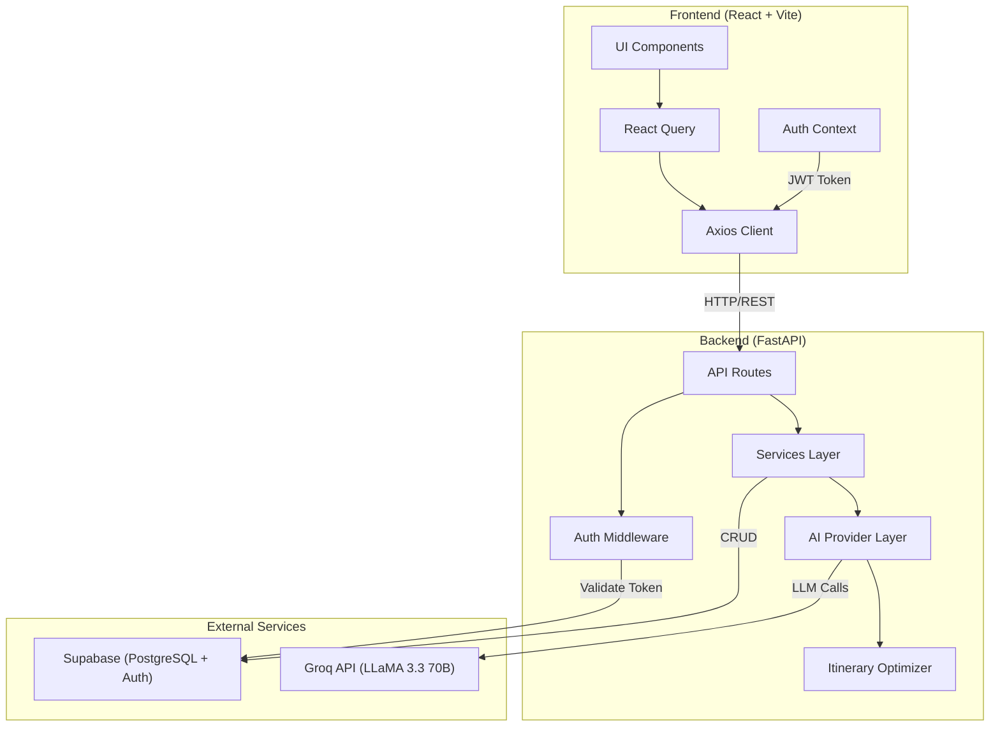
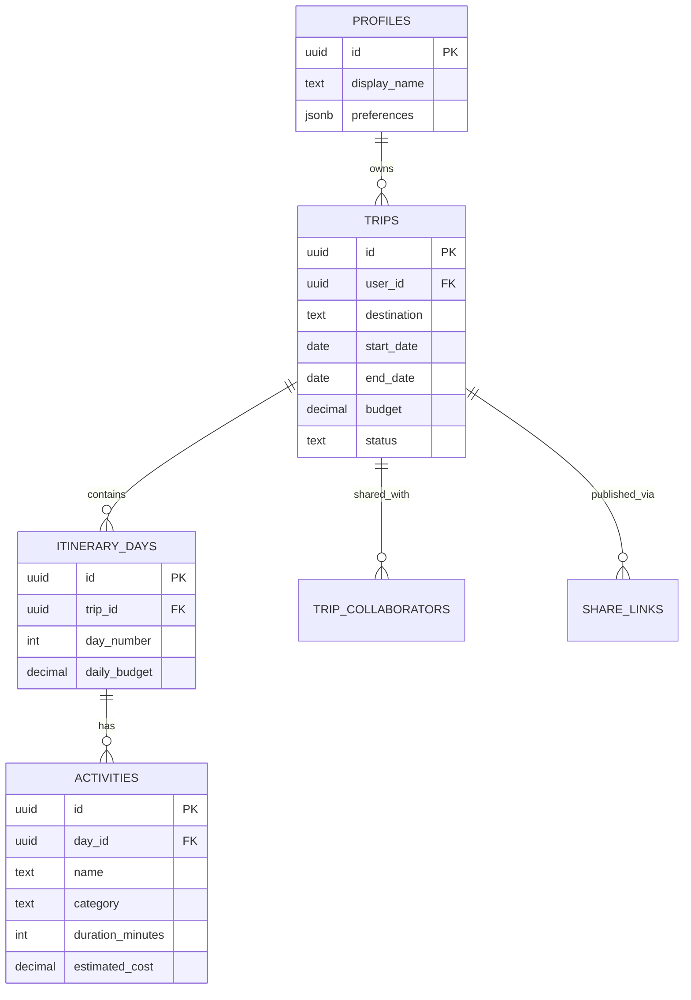

# Architecture Overview — WanderWise AI

## System Architecture



## Frontend Architecture

| Layer | Technology | Purpose |
|-------|-----------|---------|
| Framework | React 19 + TypeScript | Component rendering, type safety |
| Build | Vite 8 | Fast HMR, production bundling |
| Styling | Tailwind CSS 4 | Utility-first responsive design |
| Animation | Framer Motion | Page transitions, hover effects |
| Icons | Lucide React | Consistent iconography |
| Routing | React Router 7 | SPA navigation, protected routes |
| Data Fetching | TanStack React Query | Caching, mutations, loading states |
| HTTP | Axios | API client with interceptors |
| Maps | Leaflet + OpenStreetMap | Interactive map visualization |
| Auth | Context API | Session management, token storage |

### Component Hierarchy
```
App
├── Layout (Navbar + Footer)
│   ├── LandingPage
│   ├── LoginPage / RegisterPage
│   └── ProtectedLayout (auth guard)
│       ├── DashboardPage
│       │   ├── DashboardStats
│       │   ├── TripCard (×N)
│       │   └── RecentTrips
│       ├── CreateTripPage
│       │   └── TripForm (7 steps)
│       │       ├── DestinationStep
│       │       ├── TravelerStep
│       │       ├── BudgetStep
│       │       ├── InterestsStep
│       │       ├── StyleStep
│       │       ├── RequirementsStep
│       │       └── ReviewStep
│       └── TripDetailPage
│           ├── ItineraryTimeline
│           │   ├── DayCard (×N)
│           │   └── ActivityCard (×N)
│           ├── BudgetSummary
│           ├── ItineraryMap
│           └── ShareDialog
├── SharedTripPage (public, no auth)
└── NotFoundPage
```

## Backend Architecture

### Module Structure
```
app/
├── api/          # HTTP layer (routes, dependencies)
├── core/         # Configuration, security utilities
├── db/           # Supabase client management
├── models/       # Domain enums
├── schemas/      # Pydantic request/response models
├── services/     # Business logic
│   ├── ai/       # LLM provider abstraction
│   ├── prompts/  # Prompt engineering templates
│   ├── itinerary/# Generation + optimization
│   └── trips/    # CRUD + sharing
└── utils/        # Helpers (haversine, date math)
```

### Request Flow
1. Client sends authenticated request with `Bearer` JWT
2. `get_current_user` dependency validates token against Supabase Auth
3. Route handler extracts path/query/body params (Pydantic validated)
4. Service layer executes business logic
5. Supabase client performs database operations
6. Response serialized through Pydantic response model

## AI Architecture

### Provider Abstraction
```python
class LLMProvider(ABC):
    @abstractmethod
    async def generate(self, prompt: str) -> str: ...

class GroqProvider(LLMProvider):    # Production: Groq API
class DemoProvider(LLMProvider):    # Fallback: deterministic demo data
```

### Generation Pipeline
1. **Prompt Construction** — `build_itinerary_prompt()` injects all user preferences
2. **LLM Call** — Groq API with JSON format enforcement
3. **Response Parsing** — Extract JSON from response (handles markdown code blocks)
4. **Pydantic Validation** — Validate against `Itinerary` schema
5. **Retry Logic** — Up to 2 retries on parse failure, fallback to demo
6. **Post-Optimization** — Geographic reordering, meal breaks, budget checks

### Optimizer
- **Haversine distance** calculation between activity coordinates
- **Nearest-neighbor TSP** for geographic activity ordering
- **Meal break validation** — ensures breakfast/lunch/dinner slots
- **Budget consistency** — validates daily costs against trip budget
- **Pacing checks** — activity count aligned with travel pace setting

## Database Architecture

### Entity Relationships


### Security
- **Row Level Security (RLS)** on all user-facing tables
- Policies enforce `auth.uid() = user_id` ownership
- Service role key used only on backend (bypasses RLS with manual checks)
- Share links use cryptographically random tokens with optional expiration
