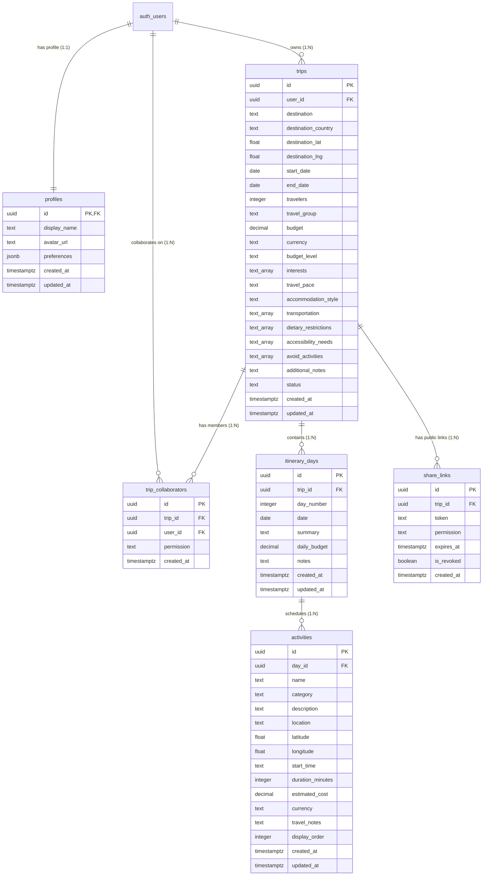

# Supabase Database & Backend Guide

This directory contains the database schema, seeds, and backend documentation for the **Personalized Travel Itinerary Planner**.

---

## Table of Contents
1. [Overview](#overview)
2. [Entity Relationship Diagram](#entity-relationship-diagram)
3. [Quick Setup Guide (Supabase Cloud)](#quick-setup-guide-supabase-cloud)
4. [Alternative: Local Development with Supabase CLI](#alternative-local-development-with-supabase-cli)
5. [Running `schema.sql` and `seed.sql`](#running-schemasql-and-seedsql)
6. [Obtaining API Keys and Project URL](#obtaining-api-keys-and-project-url)
7. [Authentication Configuration](#authentication-configuration)
8. [Database Schema & Data Dictionary](#database-schema--data-dictionary)
9. [Row Level Security (RLS) Policies](#row-level-security-rls-policies)
10. [Automated Triggers and Functions](#automated-triggers-and-functions)
11. [Troubleshooting & FAQ](#troubleshooting--faq)

---

## Overview

The database leverages PostgreSQL on Supabase to deliver:
- **Strict Data Isolation**: Enforced using PostgreSQL Row Level Security (RLS) on all tables.
- **Collaborative Planning**: Fine-grained permissions (`read`, `write`, `admin`) for team and group travel.
- **Sharable Read-Only Tokens**: Secure shareable links (`share_links`) with optional expiration and instant revocation.
- **Automated Lifecycle Hooks**: Profile initialization upon user registration and automated `updated_at` timestamps.

---

## Entity Relationship Diagram



---

## Quick Setup Guide (Supabase Cloud)

### 1. Create a Supabase Project
1. Navigate to [https://supabase.com](https://supabase.com) and log in or create an account.
2. Click **New Project** and select your organization.
3. Choose a project name (e.g. `Travel-Itinerary-Planner`).
4. Set a strong database password (store this in your password manager).
5. Choose a region closest to your users.
6. Click **Create new project** and wait ~2 minutes for provisioning to complete.

---

## Alternative: Local Development with Supabase CLI

If you prefer testing locally with Docker and the Supabase CLI:

```bash
# 1. Install Supabase CLI (if not already installed)
npm install -g supabase

# 2. Initialize and start local services in your project root
cd "d:\Personalized Travel Itinerary Planner"
supabase init
supabase start

# 3. Apply schema and seed data
supabase db reset
```

---

## Running `schema.sql` and `seed.sql`

### In the Supabase Cloud Web Dashboard:

1. Open your project dashboard at [https://supabase.com/dashboard](https://supabase.com/dashboard).
2. In the left navigation menu, click **SQL Editor** (icon: `>_`).
3. Click **New Query** (`+` button).
4. Open [supabase/schema.sql](file:///d:/Personalized%20Travel%20Itinerary%20Planner/supabase/schema.sql), copy its entire content, paste it into the editor, and click **Run** (or press `Ctrl+Enter` / `Cmd+Enter`).
5. Confirm the response returns `Success. No rows returned`.
6. To load sample demo trips (Tokyo & Kyoto 7-day trip, Iceland 4-day trip), create another query, copy [supabase/seed.sql](file:///d:/Personalized%20Travel%20Itinerary%20Planner/supabase/seed.sql), paste it, and click **Run**.
7. Navigate to the **Table Editor** on the left menu to verify that `profiles`, `trips`, `itinerary_days`, `activities`, `trip_collaborators`, and `share_links` have been populated with data.

---

## Obtaining API Keys and Project URL

Your client and server applications need two environment variables to interact with Supabase:

1. In the Supabase dashboard, click the **Settings** (gear icon) in the bottom-left sidebar.
2. Under **Project Settings**, select **API**.
3. Under **Project URL**, copy the `URL` (e.g., `https://xyzprojectid.supabase.co`).
4. Under **Project API keys**:
   - Copy the `anon` / `public` key (safe for client-side browsers and mobile apps).
   - Copy the `service_role` key (keep secret, use only in secure backend scripts or Edge Functions that bypass RLS).

### Configure Project `.env` File

Create a `.env` or `.env.local` file in your application root:

```ini
# Supabase Configuration
NEXT_PUBLIC_SUPABASE_URL=https://your-project-id.supabase.co
NEXT_PUBLIC_SUPABASE_ANON_KEY=eyJhbGciOiJIUzI1NiIsInR5cCI6IkpXVCJ9...

# Server-side only (Optional / Admin tasks)
SUPABASE_SERVICE_ROLE_KEY=eyJhbGciOiJIUzI1NiIsInR5cCI6IkpXVCJ9...
```

---

## Authentication Configuration

1. In your Supabase dashboard sidebar, click **Authentication** -> **Providers**.
2. **Email Provider**:
   - Ensure **Enable Email provider** is turned **ON**.
   - For rapid local development or prototyping, toggle **Confirm email** to **OFF** (users can log in immediately upon signup without verifying their inbox). For production, turn this **ON**.
3. **OAuth Providers** (Optional):
   - To support "Sign in with Google", expand the Google accordion, supply your Google Cloud Console Client ID and Client Secret, and register the provided callback URL in Google Cloud Console.
4. **URL Configuration**:
   - Under **Authentication** -> **URL Configuration**:
     - **Site URL**: Set to `http://localhost:3000` (development) or your production domain (e.g., `https://my-travel-planner.com`).
     - **Redirect URLs**: Add `http://localhost:3000/**` to allow redirect flows for auth callbacks and password resets.

---

## Database Schema & Data Dictionary

### 1. `profiles`
User metadata extending Supabase Auth (`auth.users`).

| Column | Type | Constraints | Description |
|---|---|---|---|
| `id` | `UUID` | Primary Key, References `auth.users(id)` ON DELETE CASCADE | Unique user identifier |
| `display_name` | `TEXT` | Nullable | Public display name |
| `avatar_url` | `TEXT` | Nullable | URL to user's avatar image |
| `preferences` | `JSONB` | Default `'{}'` | Custom preferences (theme, home airport, default currency, units) |
| `created_at` | `TIMESTAMPTZ` | Default `NOW()` | Timestamp created |
| `updated_at` | `TIMESTAMPTZ` | Default `NOW()` | Timestamp last modified (auto-updated via trigger) |

### 2. `trips`
Top-level trip container storing destination, dates, budget, style, and generation state.

| Column | Type | Constraints | Description |
|---|---|---|---|
| `id` | `UUID` | Primary Key, Default `uuid_generate_v4()` | Unique trip identifier |
| `user_id` | `UUID` | References `auth.users(id)` ON DELETE CASCADE | Owner of the trip |
| `destination` | `TEXT` | NOT NULL | City, region, or country (e.g., "Tokyo & Kyoto") |
| `destination_country` | `TEXT` | Nullable | Country name |
| `destination_lat` | `DOUBLE PRECISION` | Nullable | Latitude coordinate for map view |
| `destination_lng` | `DOUBLE PRECISION` | Nullable | Longitude coordinate for map view |
| `start_date` | `DATE` | NOT NULL | Trip departure date |
| `end_date` | `DATE` | NOT NULL, CHECK (`end_date >= start_date`) | Trip return date |
| `travelers` | `INTEGER` | Default `1`, CHECK (`travelers > 0`) | Headcount of travelers |
| `travel_group` | `TEXT` | Default `'solo'`, CHECK IN (`solo`, `couple`, `family`, `friends`, `business`) | Party composition |
| `budget` | `DECIMAL(12,2)` | NOT NULL, CHECK (`budget > 0`) | Total travel budget |
| `currency` | `TEXT` | Default `'USD'` | 3-letter ISO currency code |
| `budget_level` | `TEXT` | Default `'moderate'`, CHECK IN (`budget`, `moderate`, `premium`, `luxury`) | Expenditure tier |
| `interests` | `TEXT[]` | Default `'{}'` | Array of interests (e.g., `culture`, `food`, `nature`) |
| `travel_pace` | `TEXT` | Default `'moderate'`, CHECK IN (`relaxed`, `moderate`, `fast`) | Planned daily activity intensity |
| `accommodation_style`| `TEXT` | Default `'hotel'` | Style preference (e.g., `hotel`, `hostel`, `boutique_hotel`, `resort`) |
| `transportation` | `TEXT[]` | Default `'{"public_transit"}'` | Array of transit methods (walking, rental car, subway, train) |
| `dietary_restrictions`| `TEXT[]` | Default `'{}'` | Allergies and dietary restrictions |
| `accessibility_needs` | `TEXT[]` | Default `'{}'` | Wheelchair, elevator, and mobility needs |
| `avoid_activities` | `TEXT[]` | Default `'{}'` | Blacklisted activity types (e.g., extreme sports, nightlife) |
| `additional_notes` | `TEXT` | Default `''` | Freeform prompts or special instructions |
| `status` | `TEXT` | Default `'draft'`, CHECK IN (`draft`, `generating`, `completed`, `error`) | Generation state machine status |
| `created_at` | `TIMESTAMPTZ` | Default `NOW()` | Timestamp created |
| `updated_at` | `TIMESTAMPTZ` | Default `NOW()` | Timestamp last modified |

### 3. `itinerary_days`
Represents an individual scheduled day within a trip.

| Column | Type | Constraints | Description |
|---|---|---|---|
| `id` | `UUID` | Primary Key, Default `uuid_generate_v4()` | Unique day identifier |
| `trip_id` | `UUID` | References `trips(id)` ON DELETE CASCADE | Parent trip |
| `day_number` | `INTEGER` | NOT NULL, CHECK (`day_number > 0`) | Day sequence (1, 2, 3...) |
| `date` | `DATE` | NOT NULL | Calendar date for the day |
| `summary` | `TEXT` | Default `''` | Headline summary of the day |
| `daily_budget` | `DECIMAL(10,2)` | Default `0` | Allocated target spend for this day |
| `notes` | `TEXT` | Default `''` | Daily travel notes, packing tips, or weather alerts |
| `created_at` | `TIMESTAMPTZ` | Default `NOW()` | Timestamp created |
| `updated_at` | `TIMESTAMPTZ` | Default `NOW()` | Timestamp last modified |

*Unique constraint*: `UNIQUE(trip_id, day_number)` ensures no duplicate day numbers within a single trip.

### 4. `activities`
Granular schedule items, attractions, dining stops, or transit segments.

| Column | Type | Constraints | Description |
|---|---|---|---|
| `id` | `UUID` | Primary Key, Default `uuid_generate_v4()` | Unique activity identifier |
| `day_id` | `UUID` | References `itinerary_days(id)` ON DELETE CASCADE | Parent itinerary day |
| `name` | `TEXT` | NOT NULL | Activity name (e.g., "Senso-ji Temple") |
| `category` | `TEXT` | NOT NULL | Category (e.g. `culture`, `dining`, `sightseeing`, `nature`, `transit`) |
| `description` | `TEXT` | Default `''` | Detailed description / highlights |
| `location` | `TEXT` | Default `''` | Physical address or landmark name |
| `latitude` | `DOUBLE PRECISION` | Nullable | GPS latitude |
| `longitude` | `DOUBLE PRECISION` | Nullable | GPS longitude |
| `start_time` | `TEXT` | Nullable | Suggested start time (e.g., `"09:00"`) |
| `duration_minutes` | `INTEGER` | Default `60`, CHECK (`duration_minutes > 0`) | Scheduled duration in minutes |
| `estimated_cost` | `DECIMAL(10,2)` | Default `0` | Estimated expense per person or group |
| `currency` | `TEXT` | Default `'USD'` | Currency of cost |
| `travel_notes` | `TEXT` | Default `''` | Tips (e.g., "Take Ginza Line to Asakusa Station") |
| `display_order` | `INTEGER` | Default `0` | Sequence order within the day |
| `created_at` | `TIMESTAMPTZ` | Default `NOW()` | Timestamp created |
| `updated_at` | `TIMESTAMPTZ` | Default `NOW()` | Timestamp last modified |

### 5. `trip_collaborators`
Manages shared trip access and permissions across multiple registered users.

| Column | Type | Constraints | Description |
|---|---|---|---|
| `id` | `UUID` | Primary Key, Default `uuid_generate_v4()` | Unique collaborator record ID |
| `trip_id` | `UUID` | References `trips(id)` ON DELETE CASCADE | Target trip |
| `user_id` | `UUID` | References `auth.users(id)` ON DELETE CASCADE | Invited user |
| `permission` | `TEXT` | Default `'read'`, CHECK IN (`read`, `write`, `admin`) | Access level |
| `created_at` | `TIMESTAMPTZ` | Default `NOW()` | Membership timestamp |

*Unique constraint*: `UNIQUE(trip_id, user_id)` ensures a user is attached to a trip once.

### 6. `share_links`
Secure, revocable tokens for sharing itineraries publicly or via a direct link.

| Column | Type | Constraints | Description |
|---|---|---|---|
| `id` | `UUID` | Primary Key, Default `uuid_generate_v4()` | Unique share link ID |
| `trip_id` | `UUID` | References `trips(id)` ON DELETE CASCADE | Target trip |
| `token` | `TEXT` | NOT NULL, UNIQUE | Cryptographic or slug token (e.g., `tokyo-kyoto-autumn-2026-demo`) |
| `permission` | `TEXT` | Default `'read'`, CHECK IN (`read`, `write`) | Access capability |
| `expires_at` | `TIMESTAMPTZ` | Nullable | Optional link expiration date |
| `is_revoked` | `BOOLEAN` | Default `FALSE` | Toggle to immediately invalidate the link |
| `created_at` | `TIMESTAMPTZ` | Default `NOW()` | Timestamp created |

---

## Row Level Security (RLS) Policies

Every table has Row Level Security enabled (`ALTER TABLE ... ENABLE ROW LEVEL SECURITY`). This guarantees that queries from client libraries (using `NEXT_PUBLIC_SUPABASE_ANON_KEY`) can only access data belonging to the authenticated user.

- **`profiles`**:
  - `SELECT`: `auth.uid() = id`
  - `INSERT`: `auth.uid() = id`
  - `UPDATE`: `auth.uid() = id`
- **`trips`**:
  - `SELECT`: Trip owner (`auth.uid() = user_id`) OR any user in `trip_collaborators`.
  - `INSERT`: Trip owner (`auth.uid() = user_id`).
  - `UPDATE`: Trip owner OR collaborator with `write` / `admin` permission.
  - `DELETE`: Trip owner only.
- **`itinerary_days` & `activities`**:
  - `SELECT`: Accessible if user owns the parent trip OR is a registered collaborator.
  - `ALL`: Manageable by owner OR collaborators with `write` / `admin` permission.
- **`trip_collaborators`**:
  - Full management by trip owner. Collaborators can view their own membership rows.
- **`share_links`**:
  - Full management by trip owner. Valid unrevoked tokens can be queried publicly.

---

## Automated Triggers and Functions

### 1. Auto-updating `updated_at` timestamps
```sql
CREATE OR REPLACE FUNCTION public.update_updated_at()
RETURNS TRIGGER AS $$
BEGIN
    NEW.updated_at = NOW();
    RETURN NEW;
END;
$$ LANGUAGE plpgsql;
```
Automatically triggers `BEFORE UPDATE` on `profiles`, `trips`, `itinerary_days`, and `activities`.

### 2. Auto-creating user profile on signup
```sql
CREATE OR REPLACE FUNCTION public.handle_new_user()
RETURNS TRIGGER AS $$
BEGIN
    INSERT INTO public.profiles (id, display_name, avatar_url)
    VALUES (
        NEW.id,
        COALESCE(
            NEW.raw_user_meta_data->>'display_name',
            NEW.raw_user_meta_data->>'full_name',
            split_part(NEW.email, '@', 1)
        ),
        COALESCE(
            NEW.raw_user_meta_data->>'avatar_url',
            NEW.raw_user_meta_data->>'picture',
            ''
        )
    )
    ON CONFLICT (id) DO NOTHING;
    RETURN NEW;
END;
$$ LANGUAGE plpgsql SECURITY DEFINER;
```
Triggers `AFTER INSERT ON auth.users` to automatically populate the `profiles` table with the user's name or email handle without requiring client-side calls.

---

## Troubleshooting & FAQ

#### Q: How do I test the API with the sample demo data?
Run [supabase/seed.sql](file:///d:/Personalized%20Travel%20Itinerary%20Planner/supabase/seed.sql). It creates two sample trips with IDs:
- Japan Trip: `a1111111-1111-1111-1111-111111111111`
- Iceland Trip: `b2222222-2222-2222-2222-222222222222`

If you are logged into your web app as your own authenticated user, you can also assign these trips to yourself by running:
```sql
UPDATE public.trips 
SET user_id = 'YOUR_USER_UUID_FROM_AUTH_USERS' 
WHERE id = 'a1111111-1111-1111-1111-111111111111';
```

#### Q: Why are my queries returning empty arrays `[]`?
Supabase defaults to denying access if RLS is enabled and no policy matches. Ensure:
1. The user is logged in via `supabase.auth.signInWithPassword(...)` or OAuth before querying.
2. The `user_id` on the trip matches the logged-in user's `auth.uid()`.
3. If querying on the backend without user context, use the `SUPABASE_SERVICE_ROLE_KEY` to bypass RLS.
